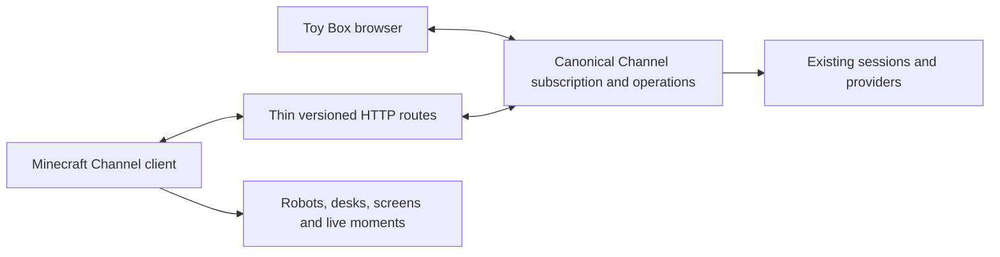

# A native Minecraft client for Channels

Toy Box owns durable collaboration and work. This project owns a Minecraft presentation of
that same Channel model. Both the browser and game observe the canonical channel subscription.

## Domain and state

`client.channel.ChannelModel.State` mirrors the canonical reduced state: channel metadata and task tree,
lead and members, full public message variants and reactions, presence, pending request,
artifacts and routines. Wire records are immutable. `ChannelReducer` applies canonical typed
updates; `ChannelChanges.diff(previous, next)` derives transient presentation moments.
Renderers read the same native state. There are no goals, repositories, decision queues or
Foreman records between the wire and those views.

Without a cursor, the stream starts with `{ type: "snapshot", state }`. The state is flat,
includes its durable `revision`, and has no wire-version field. JSON responses add `version: 1`
at the HTTP boundary. A client with cached
state supplies `after` (or `Last-Event-ID` when reconnecting) and receives missed typed events
then `resumed` with a complete presence map. Zero is a valid revision; an absent cursor means there is no cached state.
When replay is unavailable, an authoritative snapshot replaces cached history. Live
updates carry revisioned messages, reactions, roster/status, tasks, model and read events, plus
sparse runtime presence, followed
by terminal deletion when the channel is removed. Minecraft reconnects without a history cursor
and replaces its bounded transcript. Initial and reconnect snapshots
do not replay speech, celebrations or notifications. The Java transport uses HTTP/1.1,
heartbeat/handshake timeouts and synchronized connection generations; stale callbacks cannot
replace a newer connection. Failed message sends are never automatically retried.

## Generic server capabilities

| Request | Contract |
| --- | --- |
| `GET /api/v1/channels` | Versioned existing Channel catalog, refreshed explicitly by the picker |
| `GET /api/v1/channels/:id` | Canonical Channel stream, including initial or recovery snapshots |
| `POST /api/v1/channels/:id/messages` | Ordinary user message with caller-owned ID; duplicate IDs conflict |
| `POST /api/v1/channels/:id/read` | Monotonic owner read receipt through an observed sequence |

Channel semantics remain server-owned. Reading is distinct from acknowledging a request,
and acknowledging a public request is distinct from approving a provider operation. A member
leaving does not mean their session stopped. `resolveChannelAudience` is ported purely for the
composer preview; the server still performs actual delivery.

Artifacts retain their file identity and canonical resource URL. Attachments are either `{name, url}`
or an inline `{mimeType, base64}` upload; no parallel URL list or machine paths reach the client. The existing `/api/serve` and
`/api/watch` file surface supplies live Markdown without another persistence or streaming
model. The request is included separately because it can precede the latest 100 messages.
The fixture harness in `tools/fixtures/` uses Toy Box's database and `getChannelSnapshot`,
then supplies Java contracts, the isolated demo server and capture tooling.

The browser uses TanStack Query's streamed query for observation and retained paged history.
It connects to the same `/api/v1` SSE endpoint as Minecraft. Posts, read acknowledgements and
other browser commands still use TanStack server functions; those and the HTTP routes call the
same canonical backend operations. Workspace deletion remains useful to lists and clients
without a channel stream. No Minecraft concept, database migration or alternate runtime is introduced.

Full transcript snapshots are reserved for bootstrap and unrecoverable cursors. Missing channels
send a terminal deleted event, including on connection. The complete state reducer derives
metadata and attention from messages; task/model/read events carry durable changes without
inventing transcript messages. Reading carries only the clamped cursor. `completedSequence` derives completion attention against
that cursor; `requestSequence` identifies a pending request until a reply clears it. Runtime presence
is independent of durable public status: live maps merge, while `resumed` replaces the map. Durable snapshot fields
are read in one transaction. The TypeScript/Java conformance trace is generated by `bun run fixture`
from real Toy Box commits. Each transaction compares SQL metadata to the TypeScript reducer before
the resulting trace verifies the Java port.

## Code ownership

The source follows the client experience: `client.channel` observes and reduces server state;
`client.screens` reads it and posts ordinary replies; `client.agents` and `client.world` make it
visible in Minecraft. `world` builds the physical space and `world.layout` names its anchors.
Shared widget styling and drawing belong to `client.ui`; channel composition belongs to
`client.screens`; opt-in diagnostics belong to `client.dev`.
See [the client map](../mod/FEATURES.md) for each boundary's nouns and operations.

There is one world builder. Its stored blueprint distinguishes player edits from generated cells;
that persistence is retained. The temporary prototype room, builder registry, agent extension
hooks, unused animation states, and per-page feature wrappers are gone.

## Presentation ownership

Robot skin and portrait textures render the agent's own SVG mark and color. Stable ID-derived
body variants provide silhouettes. Desk assignments remain stable across reorder/reconnect;
the default hall holds twelve desks, and overflow pods require verified clear footprints and
preserve player edits. Working agents use desks, waiting agents use the coral seating area
with their reason and `wakeAt`, and idle agents use the mint lounge. A pending public request
brings its sender to the podium. `lookingAt` and `workingOn` reference public message
sequences. Routine schedules remain in server-local time; the client does not invent next runs.

Minecraft owns avatar rendering, walk animation, particle simulation/rendering and block state
updates. Toy Box owns the channel-to-place decisions, chair-aware movement and poses, nameplate
layout, and effect recipes. The local pathfinder is intentionally small: vanilla mob navigation
requires a different entity model. The builder's saved blueprint is likewise intentional: it preserves
player edits on rebuild. World checks and synthetic keyboard input live under `client.dev`;
seat diagnostics reuse `Seats` rather than defining their own placement rules.

The transcript includes system messages and reactions. The task page preserves the hierarchy;
local row addresses are not task IDs. The artifact reader owns its fetch/watch lifetime and
rejects callbacks from previous selections. World lamps, monitors, request podium and HUD are
views of this state, with visibly stale presentation during connection loss.

`TranscriptRows` ports the browser's agent-run and system-message grouping, including day and
unread boundaries. Layout adds identity portraits and reaction chips without changing stored messages.
The picker owns its catalog request and persists a server/channel selection. Switching stops the
old transport, clears presentation state, and starts a new observer using the same listeners;
queued callbacks from the old transport remain rejected by its existing generation guard.

## Upstream foundation

The assessment used [AgentCraft commit 0be815d](https://github.com/blendi-remade/agentcraft/tree/0be815deb4833a9ce0f070c29737bba882e98759).
Reusable pieces include Fabric wiring, anchored world building that preserves edits, block
geometry, local pathfinding and animation, world UI rendering, Markdown layout, deterministic
asset generation and framebuffer capture. Its orchestration model, fixed cast, goals, decision
intents, provider permissions and merge workflows have been removed from the shipped client.

Java packages use `dev.toybox.minecraft`; registered resources use `toybox_minecraft`. The fresh
namespace is intentional before distributing a jar. Pre-refactor development saves are not
migrated automatically; the new default workshop save is separate. MIT attribution remains in
LICENSE and THIRD_PARTY_NOTICES.md.
